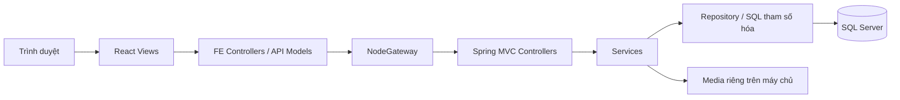

# MVC2 và bảo mật

## Phân lớp

React là View, Spring MVC điều khiển request và nghiệp vụ. Node.js phục vụ FE và gateway. FE cũng chia models/controllers/views. Migration và seed đặt riêng trong database/; Maven đóng gói vào classpath khi build, Flyway áp dụng migration khi API khởi động.

| Nhóm dữ liệu | Bảng |
|---|---|
| Tài khoản | app_users |
| Nội dung riêng | contributions, media_files |
| Thẩm định | review_decisions, lưu snapshot và bằng chứng |
| Công khai | published_tips, moderation_actions |
| Sổ tay | bookmarks, learning_progress |
| Quản trị | feedback, audit_events |
| Phiên và rate limit | SPRING_SESSION*, rate_buckets |

SQL runtime có đọc/ghi nhưng không có DDL; DENY sửa/xóa nhật ký và quyết định. Login migration có db_owner chỉ trong database ứng dụng. Tiến trình API hiện giữ cả hai cấu hình khi khởi động; hệ thống có yêu cầu cao hơn nên chạy migration thành job riêng và bỏ credential migration khỏi API sau đó.

```mermaid
stateDiagram-v2
  [*] --> DRAFT
  DRAFT --> SUBMITTED: Tác giả gửi
  SUBMITTED --> IN_REVIEW: Người khác nhận
  IN_REVIEW --> CHANGES_REQUESTED: Cần bổ sung
  CHANGES_REQUESTED --> SUBMITTED: Sửa và gửi lại
  IN_REVIEW --> REJECTED: Từ chối
  IN_REVIEW --> APPROVED: Kiểm tra đủ và có bằng chứng
  APPROVED --> [*]: Xuất bản
```

Version ngăn lưu đè/tranh nhận bài. Bài đang gửi/duyệt không cho tác giả sửa. Quyết định và bản công khai được ghi trong cùng transaction. Gỡ bài chỉ thay đổi hiển thị và ghi lý do.

## 10 hạng mục bảo mật được yêu cầu

| Hạng mục | Thực thi |
|---|---|
| Biến môi trường | env/; secret thật bị Git/Docker ignore, file local giới hạn ACL |
| Tách lớp | FE / BE / NodeGateway / database; controllers, services, repository, middleware |
| Lỗi tập trung | Spring ErrorHandler, Node error middleware; không trả SQL/stack trace; Node fatal exit để supervisor restart |
| Validate | Jakarta Validation và nghiệp vụ BE; Zod cho config gateway; FE hỗ trợ nhập liệu |
| Xác thực/phân quyền | BCrypt cost 12; session SQL; HttpOnly/SameSite cookie; CSRF; MEMBER/REVIEWER/ADMIN; quyền sở hữu bài/tệp |
| Migration/seed | Flyway V1–V4; seed idempotent; không giả người duyệt hoặc mật khẩu mặc định |
| Logging | Pino, request ID, status/thời gian; không log mật khẩu, token, cookie, request body |
| Bảo mật cơ bản | Helmet/CSP, CORS allowlist, rate limit gateway/SQL, deny-by-default, SQL tham số hóa, xử lý lại media |
| Production ổn định | Docker restart, healthcheck, readiness, non-root/read-only cho API/web; script start/stop local |
| Backup | SQL COPY_ONLY/CHECKSUM + VERIFYONLY; media + SHA-256; mẫu restore vào database khác |

Tham khảo cách lưu SecurityContext, cookie và CSRF của D:/DemoReview/BookingReview-BE; không sao chép bí mật hay sửa dự án tham khảo. Auth dùng session có thể thu hồi, không lưu JWT trong localStorage. Đổi mật khẩu/vai trò hoặc khóa tài khoản thu hồi phiên SQL. FE giữ CSRF token trong bộ nhớ và lấy lại sau đăng nhập.

Gateway ghi đè khóa nội bộ và X-Client-IP. Chỉ tin IP proxy khai báo trong TRUSTED_PROXY; không dùng true hoặc dải mạng công cộng. Gateway giới hạn bằng bộ nhớ tiến trình; cần shared store khi tăng replica. SQL rate limit theo email/IP tồn tại qua restart; bucket hết hạn được tái sử dụng, nên dọn bucket cũ theo chính sách lưu trữ khi vận hành dài ngày.

Media dùng UUID ngoài webroot. JPEG/PNG phải giải mã được, giới hạn pixel và mã hóa lại. Video kiểm tra magic, ffprobe duration/track/kích thước rồi ffmpeg tái mã hóa MP4, bỏ metadata. Giới hạn 30 MB, 60 giây, hai tác vụ đồng thời, timeout. Media riêng chỉ phục vụ tác giả/người có quyền phù hợp; media công khai hỗ trợ HTTP Range. FFmpeg Windows tải từ nguồn được FFmpeg giới thiệu, kiểm tra SHA-256; checksum không thay thế cập nhật định kỳ.

## Giới hạn hiện tại

- Quy trình duyệt có người thực hiện; chất lượng phụ thuộc tài khoản được cấp quyền. Chưa có AI tự xác nhận an toàn.
- Chưa tích hợp email xác minh/khôi phục mật khẩu, MFA, antivirus chuyên dụng, hàng đợi chuyển mã phân tán.
- Session 30 phút. Local dùng HTTP; production bắt buộc HTTPS và COOKIE_SECURE=true.
- SQL container riêng dùng certificate tự ký. Với SQL ngoài mạng riêng, cài chứng chỉ hợp lệ và đặt trustServerCertificate=false.
- Backup đã VERIFYONLY; cần diễn tập restore database + media trên VPS đích. Tạm ngừng ghi khi lấy bản sao nhất quán.
- Compose đã kiểm tra cấu hình; chưa chạy container do Docker Engine trên máy chưa hoạt động.

## Tài liệu chính thức

- [Spring CSRF](https://docs.spring.io/spring-security/reference/servlet/exploits/csrf.html)
- [Spring SecurityContext](https://docs.spring.io/spring-security/reference/servlet/authentication/persistence.html)
- [Tomcat security](https://tomcat.apache.org/security-10.html)
- [SQL Server backup checksum](https://learn.microsoft.com/en-us/sql/relational-databases/backup-restore/possible-media-errors-during-backup-and-restore-sql-server)
- [Compose readiness](https://docs.docker.com/compose/how-tos/startup-order/)
